# Fairness- and Horizon-Audited Sequential Modality Acquisition for Alzheimer's Risk Stratification on ADNI

<picture>
  <source media="(prefers-color-scheme: dark)" srcset="assets/hero-dark.svg">
  <source media="(prefers-color-scheme: light)" srcset="assets/hero-light.svg">
  
</picture>

## The four acquisition blocks

Each block is bought whole, at a price-like cost roughly proportional to US list prices. The bars show each block's incremental AUC over the cheap-only model (demographics, cognition, APOE), on the subjects who hold that block (`paper/tables/modality_value.csv`, October 2026 release).

<p>
<picture>
  <source media="(prefers-color-scheme: dark)" srcset="assets/modality-mri-dark.svg">
  <source media="(prefers-color-scheme: light)" srcset="assets/modality-mri-light.svg">
  
</picture>
<picture>
  <source media="(prefers-color-scheme: dark)" srcset="assets/modality-fdg-dark.svg">
  <source media="(prefers-color-scheme: light)" srcset="assets/modality-fdg-light.svg">
  
</picture>
<picture>
  <source media="(prefers-color-scheme: dark)" srcset="assets/modality-amyloid-dark.svg">
  <source media="(prefers-color-scheme: light)" srcset="assets/modality-amyloid-light.svg">
  
</picture>
<picture>
  <source media="(prefers-color-scheme: dark)" srcset="assets/modality-csf-dark.svg">
  <source media="(prefers-color-scheme: light)" srcset="assets/modality-csf-light.svg">
  
</picture>
</p>

## Status
Pipeline, three baseline re-implementations, the policy benchmark, the
cost-matched random-acquisition sweep, the fairness audit, robustness sweeps,
clinical-utility analysis, final models and the confirmatory test-set scoring
are complete and run on real ADNI data. The manuscript is
`paper/tcsst_manuscript.tex` (compile with `pdflatex`).

**All numbers below come from the October 2026 ADNI release** (the data were
re-downloaded after a laptop reset; the cohort changed slightly). The earlier
September-release log is archived in `docs/FINDINGS_sept2026_release.md`.

**The held-out test set has been scored on two data releases** (September and
October 2026) with unchanged models and procedure; it is therefore not
untouched. All scorings are listed in `models/TEST_SET_SPENT.json`. The
manuscript reports the October scoring and discloses this (Section 3.2).

**Cohort (Oct 2026 release):** 1,566 MCI-at-baseline subjects from 3,762.
Converters 134 / 252 / 313 at 12 / 24 / 36 months, reverters 120 / 113 / 110,
censored subjects tracked separately. Development sets (complete-case, four
modalities) 402 / 366 / 334, test sets 101 / 92 / 84 (9 / 17 / 22 converters).


## What this is
Not a new fusion architecture. A **fairness and prediction-horizon audit** of three existing, published, cost-aware sequential modality-acquisition policies for Alzheimer's diagnosis on ADNI:

- **UMoS** (Zheng et al., *Alzheimer's & Dementia* 2022 / *IISE Trans. Healthcare Sys. Eng.* 2023) — MRI-model uncertainty gates amyloid-PET acquisition.
- **ProMUSE** (arXiv:2606.19371, 2026) — staged evidential (Dirichlet/Dempster-Shafer) uncertainty gating, clinical → MRI → PET.
- **Sequential-decision RL policy** (ACM ICBDSIC 2025) — DQN/PPO test-ordering policy.

None of these three report (a) disparate acquisition/error rates by race, ethnicity, or sex, or (b) whether the optimal policy changes with the prediction horizon (12 vs. 24 vs. 36 months). This project re-implements all three as baselines, then adds both audits, plus a fairness-constrained and horizon-conditioned policy variant.

**Do not claim "first to do sequential/cost-aware acquisition on ADNI."** That claim is false — the three papers above already do it. The claim is: first fairness + horizon audit of this specific line of work.

## Repo layout
```
data/
  raw/            # ADNIMERGE + supplementary tables, once ADNI access is granted (not raw images)
  processed/      # cohort-constructed, split, feature-engineered tables
src/
  preprocessing/  # cohort construction, subject-level splitting, leakage checks
  baselines/      # re-implementations of UMoS, ProMUSE, DQN-2025
  models/         # fairness-constrained / horizon-conditioned acquisition policy
  eval/           # Pareto frontiers, calibration, fairness metrics, statistical tests
notebooks/        # exploratory analysis only — nothing load-bearing lives here
paper/
  figures/
  tables/
```

## Data
Uses the **ADNIMERGE2 package's raw component tables** (217 `.rda` files),
not a single pre-merged table — that package ships the source tables rather
than one merged frame, which is preferable here since we get full raw fields.
Read with `pyreadr` (no R install required). Tables actually used:

| purpose | table |
|---|---|
| diagnosis over time | `DXSUM` |
| demographics | `PTDEMOG` |
| genotype | `APOERES` |
| cognition | `MMSE`, `CDR` |
| MRI volumes | `UCSFFSX7` + `UCSFFSX51`/`UCSFFSX6`/`UCSFFSX`/`UCSFFSX51_ADNI1_3T` |
| FDG-PET | `UCBERKELEYFDG_8mm` (MetaROI) |
| amyloid-PET | `UCBERKELEY_AMY_6MM` (`SUMMARY_SUVR`) |
| tau-PET | `UCBERKELEY_TAU_6MM` (`META_TEMPORAL_SUVR`) |
| CSF | `UPENNBIOMK_ROCHE_ELECSYS` |
| plasma | `C2N_PRECIVITYAD2_PLASMA` |
| scanner field strength | `MRIMETA` (1.5T) + `MRI3META` (3T) |

No raw MRI/PET image preprocessing is required. FreeSurfer ROI codes were
looked up in `DATADIC_01Sep2026.csv` and verified per table.

**Visit codes:** all merges join on the harmonized `VISCODE2` (`bl`, `m06`,
…), never raw `VISCODE`, which is protocol-specific and not comparable
across phases. Screening visits coalesce into baseline where no true `bl`
row exists, with a genuine `bl` row always winning.

## Non-negotiable rigor rules
- **Subject-level train/val/test splits, enforced before any preprocessing statistic is computed.** This is the single largest source of inflated accuracy documented in this field (a 28-point swing in one directly-audited case).
- Stratify and report separately by scanner/field-strength (ADNI-1 1.5T vs. ADNI-2/3 3T).
- MCI reverters are a distinct label category, never silently merged into "stable."
- Report calibration (Brier score, reliability) and decision-curve analysis, not AUC alone.
- Report fairness metrics (equalized odds, equal opportunity, demographic parity) for every model, including the three re-implemented baselines.

## Milestones
1. ✅ ADNI data obtained (ADNIMERGE2 package: 235 raw `.rda` tables in the Oct 2026
   release, plus the data dictionary). Read via `pyreadr`; no R install needed.
2. ✅ Cohort construction + leakage-safe subject-level splits, verified on
   real data. Scanner-stratified splits confirmed balanced.
3. ✅ Modality-value experiment (`src/eval/run_modality_value.py`).
4. ✅ Horizon-effect experiment with formal trend tests
   (`src/eval/run_horizon_effect.py`).
5. ✅ Re-implemented UMoS, ProMUSE and DQN-2025 (`src/baselines/`) and
   benchmarked them at 12/24/36 months.
6. ✅ Fairness audit of acquisition behaviour (`src/eval/fairness.py`).
7. ✅ Horizon-conditioned acquisition policy (`src/baselines/horizon_conditioned.py`)
   — tested against horizon-swapped controls; null (Findings §7).
8. ⛔ Fairness-constrained policy variant — **premise removed**. Findings §4
   found no FDR-surviving acquisition disparity to correct, so building a
   constraint against it would be fixing a problem the data does not show.
9. ✅ Full evaluation: cost-accuracy frontiers, calibration, decision-curve
   analysis, fairness tables, plus a three-way robustness sweep.
10. ⬜ Re-run the systematic literature search before finalising the
    novelty claim.
11. ✅ Manuscript drafted (`paper/`); reference check and journal formatting pending.
12. ✅ Final models trained, documented and persisted (`models/`).
13. ✅ Test set scored on the September and October 2026 releases; Oct results in Findings.
14. ✅ Cost-matched random-acquisition sweep (`src/eval/run_random_sweep.py`).
15. ✅ Dev-vs-test gap check (`src/eval/investigate_test_gap.py`, descriptive only).

## Findings (October 2026 release)
Reproduce everything with `logs/run_all.sh`, then
`python -m src.eval.run_final_test --i-am-sure --horizon H` for H in 12, 24, 36
and `python -m src.eval.make_paper_figures`. Tables are in `paper/tables/`.

### 1. Random acquisition is a curve, not a number
`src/eval/run_random_sweep.py` sweeps the per-modality acquisition rate from 0
to 1 (50 seeds per rate, an independent draw per patient). Random AUC rises
from the cheap-only value to the acquire-all value (24 mo: 0.810 to 0.893) and
is 0.846 / 0.870 / 0.868 at rate 0.5 (12 / 24 / 36 mo). Seed SD at
intermediate rates is 0.004-0.019; the subject-bootstrap CI half-width is
0.03-0.06. (The earlier single-seed baseline reused one random stream in every
CV fold and happened to land high at 24 months; it is retired.)

### 2. Policy benchmark vs cost-matched random (the central result)
Each policy is compared with random acquisition at the same expected cost
(per cost regime; 10,000 bootstrap resamples; Holm within a family of 13
policies per horizon and regime).
- Published policies, price-like costs: 25 of 27 pairs show no significant
  difference after Holm. One better (RL, cost weight 0.05, 12 mo, adj. p =
  0.014), one worse (evidential full ladder with its own neural predictor, 12
  mo, adj. p = 0.003). Unadjusted: 2 better, 3 worse.
- Flat costs: 0 better, 1 worse after Holm. Burden costs: 2 better (the same RL
  gain; the 25%-escalation cascade at 36 mo) and 1 worse. The gains depend on
  the cost regime and never recur across horizons.
- Dominated by a patient-independent fixed rule costing no more: 19 of 27
  pairs (price-like), 12 (flat), 16 (burden); 12 under all three.
- Fixed rules and SPFA beat matched random: SPFA MRI-only +0.056 (24 mo,
  adj. p = 0.010) and +0.046 (36 mo, adj. p = 0.016); MRI+FDG is nominal only
  (adj. p 0.42 / 0.097 / 0.067).

### 3. SPFA (signature features + pooled training)
Nested-CV AUC (selection optimism +0.0016): MRI-only 0.872 / 0.883 / 0.860
at cost 1.0; MRI+FDG 0.885 / 0.897 / 0.885 at cost 3.0; acquire-all 0.862 /
0.893 / 0.898 at cost 9.5. Paired vs acquire-all (development CV): no
significant difference except MRI-only at 36 mo (-0.036, CI -0.068 to -0.004).
Ablation at 24 mo, MRI-only state: both ingredients +0.034 (CI +0.007 to
+0.063), pooling alone +0.019 (significant), expanded features alone +0.013
(not).

### 4. Held-out test (scored on both releases; Oct results)
| model | cost | 12 mo | 24 mo | 36 mo |
|---|---|---|---|---|
| cheap_only | 0.0 | 0.916 | 0.850 | 0.831 |
| ours_MRI | 1.0 | 0.944 | 0.908 | 0.855 |
| ours_MRI+FDG | 3.0 | 0.951 | 0.901 | 0.903 |
| fixed_MRI+FDG | 3.0 | 0.934 | 0.887 | 0.900 |
| acquire_all | 9.5 | 0.928 | 0.922 | 0.944 |

Neither SPFA point is significantly worse than acquire-all at any horizon
(weakest: MRI-only at 36 mo, -0.089, CI -0.186 to +0.000). The test sets hold
9 / 17 / 22 converters, so this is not evidence of equivalence. Sept and Oct
scorings differ by at most 0.011 AUC.

### 5. Why test AUC sits above development AUC (descriptive, post hoc)
12-month test AUCs are 0.066-0.099 above development for all five models, at
the 92nd-99th percentile of random same-size subsets of the development OOF
predictions (SD 0.04-0.06); at 24 / 36 months they are at the 41st-95th
percentile. Test and development baselines are similar (|SMD| <= 0.23,
prevalence matched). Consistent with small-sample variation; nothing was tuned
on these checks (`paper/tables/test_gap_*.csv`).

### 6. Fairness and representation
Non-White share falls from 14.2% (n = 1,566) to 9.1% (labelled) to 5.9%
(complete-case, n = 458) at 24 mo. Among MCI participants ADNI4 is 38.8%
non-White but only 16.3% have a 24-month label. The 366-participant audit
cohort has 9 Black, 9 Hispanic and 4 Asian participants and no converters in
any of them: race-stratified auditing is infeasible. This is a data limitation,
not evidence about the policies. On sex (213 male, 153 female) no acquisition
gap survives Benjamini-Hochberg (two reach p = 0.050 uncorrected).

### 7. Other analyses (all with the 12-measure MRI block)
- Horizon effect: amyloid-PET (+0.049) and CSF (+0.040) value rises 12 to 36
  mo; MRI and FDG do not. A horizon-conditioned policy does not beat
  horizon-swapped controls.
- Robustness: gradient boosting lowers AUC for every policy; across seeds
  acquire-all ranks first and fixed MRI and cheap-only last.
- Calibration (24 mo): slope 0.828 cheap-only, 0.780 random, 0.733-0.756
  published, 0.725 acquire-all, 1.08-1.10 SPFA.

### Implication for the paper
1. Per-patient selection adds nothing to what the same budget buys at random,
   whereas a fixed rule with good inputs beats both.
2. SPFA's MRI-only point is the best-supported cost saving.
3. ADNI cannot yet support a race-fairness audit of conversion models.
